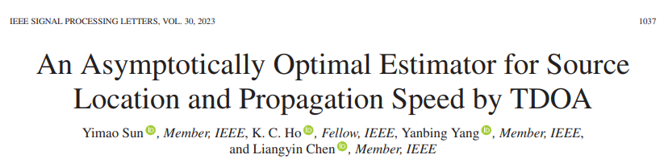
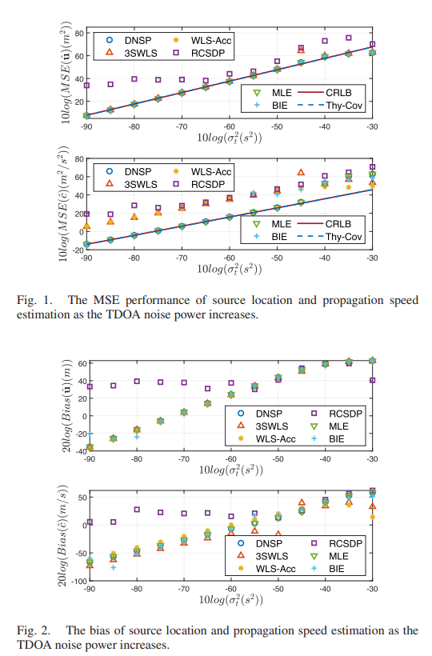

# [TDOA] Sound Source Localization and Approaching Optimal Estimator Based on Time Difference of Arrival (TDOA) [with MATLAB Code]

Abstract: In environments with unknown signal propagation speeds such as solids and oceans, acoustic signals can propagate. When locating such sources using multiple sensors to receive signals, it is necessary to jointly estimate the source position and the signal propagation speed. This paper applies the zero-space projection method to a pseudo-linear model of the localization problem, obtaining a closed-form solution. The solution is then optimized through error compensation, ultimately achieving estimation. Unlike existing methods that either yield suboptimal results or are computationally intensive, the proposed method combines statistical validity with computational efficiency. Furthermore, analytical proof indicates that this method can achieve Cramér-Rao Lower Bound (CRLB) accuracy.
Introduction: Acoustic source localization is one of the fundamental tasks in numerous applications and services, attracting significant attention over the past decades [1]-[3]. Typically, source localization relies on parameters extracted from the transmitted signal, such as Time of Arrival (TOA), Time Difference of Arrival (TDOA), or Angle of Arrival (AOA) [3]-[8]. Among these, TDOA is widely applied in non-cooperative localization due to its high localization accuracy without requiring synchronization with the source [8]-[11].
The propagation speed of electromagnetic signals in free space is approximately constant and equal to the speed of light. However, in environments such as underwater, the range of electromagnetic signals can be significantly limited, where acoustic systems exhibit unique advantages. Since the speed of sound varies with water temperature and density, treating the speed of sound as an unknown quantity is reasonable. Early studies [12] used Time Difference of Arrival (TDOA) to obtain closed-form solutions for the source position and propagation speed, but these solutions were suboptimal. To improve performance, Zheng et al. [13] adapted the multi-stage approach from [9], deriving a three-stage weighted least squares (3SWLS) solution. In two-dimensional scenarios, this method's Mean Squared Error (MSE) was close to the Cramer-Rao Lower Bound (CRLB). Zhang et al. [14] also based their approach on the two-stage method from [9], combining TDOA and the difference of arrival frequency (FDOA) measurements to solve the problem, but their performance still did not reach optimal levels. Zhu et al. [15] proposed a dual-iterative estimator (BIE), which estimates both the source position and propagation speed through alternating iterations. Although this approach achieves good performance, each iteration requires the use of CVX tool to solve the semidefinite programming (SDP) problem, resulting in significant computational overhead. Research [17] started from the Maximum Likelihood Estimator (MLE) and provided a convex optimization solution for this non-iterative problem through semidefinite relaxation (SDR). Qi et al. [18] adopted an improved polar coordinate representation method [11] and proposed a rank-constrained semidefinite programming (RCSDP) solution. However, this method could only achieve CRLB accuracy when the measurement covariance matrix is diagonal.
Existing literature proposes various methods for joint estimation of source position and propagation speed, but neither closed-loop estimators nor SDP-based solutions can simultaneously achieve CRLB performance for both estimates — even when some methods approach CRLB in two-dimensional scenarios [13], [17], or specific scenarios [14], [18]. Moreover, these methods are only validated through simulations, lacking sufficient theoretical support. To our knowledge, there is currently no algorithm based on TDOA that can achieve CRLB performance both analytically and through simulations.
This paper introduces a new algorithm, the Double Zero Space Projection (DNSP), for joint estimation of source position and propagation speed, taking into account sensor position errors. The first zero space projection eliminates unknowns related to propagation speed, transforming the original model into a linear equation solely concerning the source position; the second zero space projection removes quadratic terms generated by rough propagation speed estimates, simplifying the calculation process. However, these projection steps overlook the relationship between actual unknowns and intermediate parameters, resulting in suboptimal solutions. The final error compensation step of the DNSP algorithm utilizes these overlooked relationships to enhance estimation accuracy. Theoretical analysis indicates that under Gaussian noise with low intensity, the MSE of the proposed algorithm can achieve CRLB. Simulation results validate this theoretical conclusion, also proving that the DNSP algorithm offers superior performance compared to existing methods.
The contributions of this paper include:
1. 
Proposing a novel joint estimation model for location and propagation speed. This model employs zero space projection to remove interference parameters from a pseudo-linear model, leading to a closed-form solution, DNSP.
2. 
Conducting an MSE analysis. The analysis results indicate that when measurement noise and sensor position errors follow Gaussian distributions with low intensity, both location estimation and propagation speed estimation can achieve CRLB.
3. 
Verifying through simulation. Simulation results confirm that the DNSP algorithm outperforms existing methods in terms of estimation accuracy and computational efficiency.
In this paper, bold uppercase letters / symbols represent matrices, bold lowercase letters / symbols represent column vectors; superscript "o" denotes its true value; the Euclidean norm of a vector is represented by ⊤ {・}; a diagonal matrix consisting of elements of a vector is denoted by diag {・}; superscript "⊤" and "-1" respectively denote the transpose and inverse operations; a subvector formed by the elements from the i-th to the j-th position of a vector is represented by ⊙; ⊗ represents the Kronecker product; ℝ denotes the set of real numbers.
Conclusion: This paper proposes a new closed-form solution for the localization problem based on Time Difference of Arrival (TDOA) under unknown propagation speed scenarios. The method projects the pseudo-linear equations successively onto the null space of intermediate parameters to obtain an approximate estimate of the source location and propagation speed. Subsequently, an error compensation step reduces the Mean Square Error (MSE) to the Cramer-Rao Lower Bound (CRLB) level, which has been proven analytically and validated through numerical simulations. The proposed DNSP algorithm outperforms existing methods in terms of both performance and efficiency: simulation results show that the MSE and bias of the DNSP algorithm reach the level of MLE, while its computational time is comparable to other closed-form solutions.
The method achieves localization through multiple stages, and future research could explore single-stage solutions, such as utilizing Generalized Trust Region Subproblem (GTRS), which holds promise as an interesting research direction.
End

## Images

<!-- PAYMENT_BLOCK -->

## Get this dataset

- Payment link (Stripe): [Buy now](https://buy.stripe.com/3cs8yP7sY87d0vu9AB)
- Payment QR code: 

<!-- /PAYMENT_BLOCK -->
